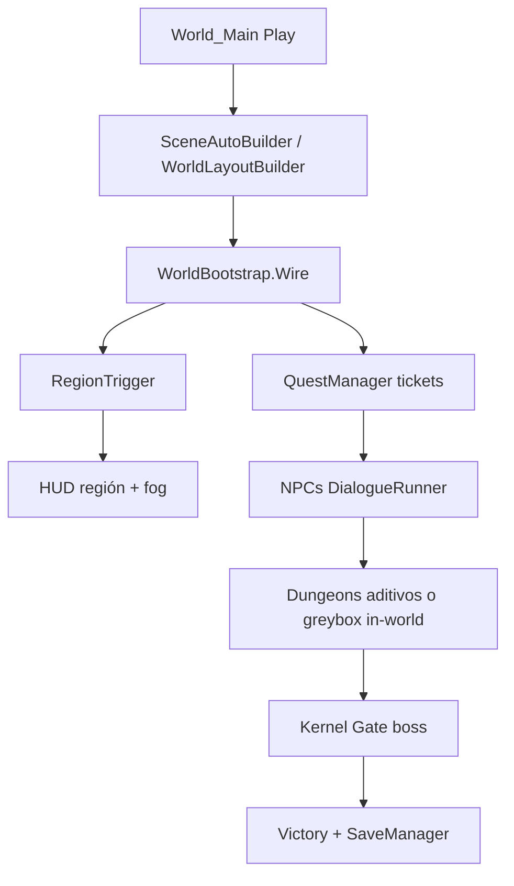

# Arquitectura — NullBorn

Documento de arquitectura Unity 6 + URP. Visión creativa: [`docs/GDD_v2.md`](docs/GDD_v2.md). Slice legacy: [`docs/GDD_v1.md`](docs/GDD_v1.md) y **Demo_10min**. Plan de mundo: [`docs/WORLD_RPG_PLAN.md`](docs/WORLD_RPG_PLAN.md). Complementa [`docs/REQUIREMENTS.md`](docs/REQUIREMENTS.md).

**Estado:** fases **0–9** del plan open-world RPG están implementadas en código (greybox + combate 0b + RPG + save + API mock). PostgreSQL / REST real siguen pendientes.

## Visión general

```
┌─────────────────────────────────────────────────────────────┐
│  World_Main.unity  (overworld)     Combat_Arena.unity (0b)  │
│  Demo_10min.unity  (legacy tutorial embebido)               │
│  ┌──────────────┐  ┌─────────────┐  ┌─────────────────────┐ │
│  │ Player_Thread│  │ GameSystems │  │ Regiones / NPCs     │ │
│  │ combate v2   │  │ bootstrap   │  │ quests / dungeons   │ │
│  └──────┬───────┘  └──────┬──────┘  └──────────┬──────────┘ │
│         └─────────────────┼─────────────────────┘           │
│                           ▼                                 │
│         Save JSON local  +  INullBornApi (mock)             │
└─────────────────────────────────────────────────────────────┘
                           │
              (Fase 9)     ▼
                   REST real → PostgreSQL OLTP (pendiente)
```

Escenas vacías se **autogeneran en Play** (`SceneAutoBuilder`) si no hay `Player_Thread`. En editor: **NullBorn → Build World Main / Build Combat Arena / Build Dungeon Scenes**.

## Estructura de carpetas (`Assets/Scripts/`)

| Carpeta | Responsabilidad |
|---|---|
| `Bootstrap/` | `DemoBootstrap`, `PrototypeBootstrap` — demo/prototype |
| `Core/` | `SystemIntegrity`, `CpuCycles`, `GameSession`, `CheckpointSystem`, `RamPressure` |
| `Player/` | Movimiento, Corte de Traza, Purga, Restaurar, lock-on, feedback, progresión |
| `Enemies/` | `MemoryLeakEnemy` FSM, `MemoryFragment`, variantes Goteo/Propagador/Núcleo/NullRef |
| `World/` | `WorldBootstrap`, regiones, layout procedural, dungeons, fast travel |
| `RPG/Quest` | `QuestManager`, `QuestDefinition` |
| `RPG/Dialogue` | `DialogueRunner` |
| `RPG/Inventory` | Memory Cache |
| `RPG/Economy` | `CpuCredits`, `Shop` |
| `NPC/` | `NpcController`, `NpcPatrol` |
| `Persistence/` | `SaveData`, `LocalSaveProvider`, `SaveManager` |
| `Api/` | `INullBornApi`, `MockNullBornApi`, `NullBornApiClient` (stub REST) |
| `Demo/` | Flujo lineal legacy |
| `UI/` | `CanvasHUD` (Vitalidad/Energía + overlays de mundo) |
| `Art/` | Avatares, VFX, materiales runtime |

### Arte procedural (`Assets/Scripts/Art/`)

| Script | Función |
|---|---|
| `ThreadAvatarBuilder` | Primitivas URP del jugador + `SimpleBobAnim` |
| `LeakAvatarBuilder` | Esferas del leak |
| `SimpleBobAnim` | Bob idle placeholder |
| `WorldZoneSign` | Cartel 3D |
| `GcPulseVfx` / `CombatVfx` | Pulsos de GC / Purga / Restaurar |
| `RuntimeMaterials` | Lit / Textured URP en runtime |
| `ProceduralTextures` | Noise, grid y skybox cubemap runtime |
| `EnvironmentKit` | Terreno, árboles, edificios, antenas, caminos, farolas |

### Editor (`Assets/Editor/`)

| Script | Función |
|---|---|
| `BuildDemo10MinScene.cs` | **NullBorn → Generar Demo 10min** |
| `BuildCombatArenaScene.cs` | **NullBorn → Build Combat Arena** |
| `BuildWorldMainScene.cs` | **NullBorn → Build World Main** |
| `BuildDungeonScenes.cs` | **NullBorn → Build Dungeon Scenes** |
| `BuildWindowsPlayer.cs` | Build ejecutable Windows |
| `SetupURP.cs` | Configuración URP inicial |

## Combate (Fase 0b — implementado)

| Sistema | Clase | Input |
|---|---|---|
| Sprint / dash i-frames / buffer | `ThirdPersonController` | Shift / Espacio |
| Corte de Traza L-L-H | `TraceCutCombo` | Click / F |
| Onda de Purga | `PurgeWaveAbility` | G |
| Restaurar | `RestoreAbility` | V |
| Lock-on | `LockOnController` | Q / click rueda |
| Hitstop, flash, shake, SFX | `CombatFeedback` | — |
| Anim Mixamo + punch procedural | `PlayerAnimBridge` | — |
| Interactuar | `PlayerInteract` | E (solo mundo; demo conserva GC en E/G) |

`DebugStrikeAbility` se desactiva si existe `TraceCutCombo`. `GarbageCollectionAbility` se desactiva si existe `PurgeWaveAbility` (el demo lineal la conserva).

**Enemigo FSM:** Idle → Telegraph → Attack → Recover. Drain pasivo reducido en adds; aura fuerte en Boss ENRAGE.

## Mundo abierto



| Región | Landmark |
|---|---|
| Runtime Plaza | Hub, NPCs, tienda, terminal |
| Heap Wilds | Goteos + Heap Cave |
| Stack Ridge | Terrazas + Stack Chasm |
| I/O Wastes | Relay Tower |
| Kernel Heights | Núcleo Corrupto |

## Persistencia y API (RF-17–20 parcial)

- **Local:** `SaveManager` → JSON en `Application.persistentDataPath` (`nullborn_save.json`). F5 guardar / F9 cargar / auto-save en terminales y quest complete.
- **API:** `NullBornApi.Current` default = `MockNullBornApi` (in-memory). `NullBornApiClient` es el stub REST (`UnityWebRequest`) para cuando exista backend. **No hay PostgreSQL ni ACID.** EventoGC se registra en el mock al usar GC o Purga.

## Isomorfismo lúdico

| Mecánica de juego | Clase / sistema | Concepto de software |
|---|---|---|
| Vitalidad | `SystemIntegrity` | Integridad del sistema |
| Energía | `CpuCycles` | Ciclos de CPU |
| Goteo / Propagador / Núcleo | `MemoryLeakEnemy` | Memory leak |
| Memory Fragment | `MemoryFragment` | RAM no liberada |
| Onda de Purga | `PurgeWaveAbility` | GC ofensivo |
| Restaurar | `RestoreAbility` | GC defensivo |
| Corte de Traza | `TraceCutCombo` | Depuración |
| Prioridad de Thread | `PlayerProgression` | Prioridad del scheduler |
| Memory Cache | `Inventory` | Caché limitada |
| Créditos de CPU | `CpuCredits` | Presupuesto de cómputo |
| Tickets | `QuestManager` | Issues / bug reports |
| Fast travel | `FastTravelTerminal` | Migración / socket |

## Escenas

| Escena | Rol |
|---|---|
| `World_Main` | Overworld principal (greybox procedural) |
| `Combat_Arena` | Playtest Fase 0b |
| `Dungeon_HeapCave` / `Dungeon_StackChasm` | Instancias aditivas (fallback in-world si no están baked) |
| `Demo_10min` | Simulación de arranque (legacy) |
| `Prototype` | Sandbox mínimo |

## UI

`CanvasHUD` — Screen Space Overlay 1920×1080:

- Barras Vitalidad / Energía / objetivo / RAM (overworld)
- Quest tracker, créditos, PT, prompt E, diálogo, inventario Tab, minimapa stub
- Overlay pausa / derrota / victoria

## Convenciones

- Namespace raíz: `NullBorn.*`
- Textos al jugador: **español**
- Singletons vía `Instance` o `FindAnyObjectByType`
- Materiales URP en `Assets/Art/Materials/` con prefijo `Mat_`
- Regenerar demo: **NullBorn → Generar Demo 10min**
- Regenerar mundo: **NullBorn → Build World Main**
