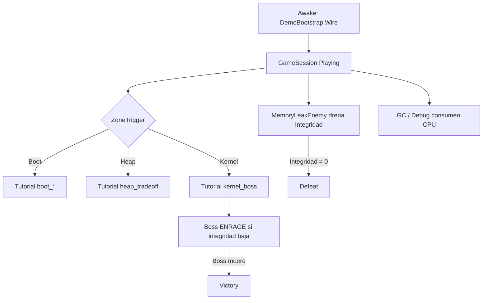

# Arquitectura — NullBorn

Documento de arquitectura del vertical slice Unity. La visión creativa y mecánica objetivo están en [`docs/GDD_v2.md`](docs/GDD_v2.md); [`docs/GDD_v1.md`](docs/GDD_v1.md) y **Demo_10min** documentan el slice legacy. Complementa [`docs/REQUIREMENTS.md`](docs/REQUIREMENTS.md).

## Visión general

```
┌─────────────────────────────────────────────────────────────┐
│                     Demo_10min.unity                        │
│  ┌──────────────┐  ┌─────────────┐  ┌─────────────────────┐ │
│  │ Player_Thread│  │ GameSystems │  │ Zona + Enemigos     │ │
│  │ + cámara     │  │ bootstrap   │  │ triggers/checkpoints│ │
│  └──────┬───────┘  └──────┬──────┘  └──────────┬──────────┘ │
│         │                 │                     │           │
│         └─────────────────┼─────────────────────┘           │
│                           ▼                                 │
│              Loop de juego (Update, triggers, UI)           │
└─────────────────────────────────────────────────────────────┘
                           │
              (roadmap)    ▼
                   API REST → PostgreSQL OLTP
```

## Estructura de carpetas (`Assets/Scripts/`)

| Carpeta | Responsabilidad |
|---|---|
| `Bootstrap/` | `DemoBootstrap`, `PrototypeBootstrap` — cableado al iniciar Play |
| `Core/` | `SystemIntegrity`, `CpuCycles`, `GameSession`, `CheckpointSystem` |
| `Player/` | Movimiento 3ª persona, habilidades GC y Debug Strike |
| `Enemies/` | `MemoryLeakEnemy`, `MemoryFragment`, variantes Basic/Spawner/Boss |
| `Demo/` | Flujo de zonas, tutoriales, triggers |
| `UI/` | `CanvasHUD` (uGUI runtime) |
| `Art/` | Avatares procedurales, animación idle, VFX mínimos, carteles de zona (ver abajo) |

### Arte procedural (`Assets/Scripts/Art/`)

| Script | Función |
|---|---|
| `ThreadAvatarBuilder` | Primitivas URP del jugador (`Visual_ThreadAvatar`); adjunta `SimpleBobAnim` al root visual |
| `LeakAvatarBuilder` | Esferas + cilindro del leak; escala por variante; adjunta `SimpleBobAnim` |
| `SimpleBobAnim` | Bob vertical en `Update` sobre avatares placeholder (idle sin Animator) |
| `WorldZoneSign` | Cartel 3D con nombre de zona |
| `GcPulseVfx` | Pulso visual al usar Garbage Collection |

Invocado desde `BuildDemo10MinScene` al generar prefabs y al instanciar avatares en Play. Los prefabs referencian `SimpleBobAnim` por GUID del `.meta`; si el GUID cambia, hay que actualizar prefabs y `Demo_10min.unity`.

### Editor (`Assets/Editor/`)

| Script | Función |
|---|---|
| `BuildDemo10MinScene.cs` | Genera escena, prefabs y materiales (`NullBorn → Generar Demo 10min`) |
| `BuildWindowsPlayer.cs` | Build ejecutable Windows |
| `SetupURP.cs` | Configuración URP inicial |

## Flujo del demo



### Secuencia de bootstrap (`DemoBootstrap`)

1. Localiza `Player_Thread`, `Main Camera`, `GameSystems`.
2. Inicializa movimiento, habilidades, cámara y `GameSession`.
3. Registra checkpoint inicial (`Checkpoint_Boot`).
4. Inicializa todos los `MemoryLeakEnemy` de escena.
5. Registra boss en `DemoFlowController`; HUD rastrea el leak **más cercano** (boss solo en Kernel).

## Isomorfismo lúdico

| Mecánica de juego | Clase / sistema | Concepto de software |
|---|---|---|
| Integridad del Sistema | `SystemIntegrity` | Estabilidad / HP del OS |
| Ciclos de CPU | `CpuCycles` | Presupuesto de cómputo |
| Memory Leak | `MemoryLeakEnemy` | Fuga de memoria (bug) |
| Memory Fragment | `MemoryFragment` | Bloque RAM no liberado |
| Garbage Collection (E/G) | `GarbageCollectionAbility` | Recolección de basura |
| Depurar (Click/F) | `DebugStrikeAbility` | Debugging / eliminar código corrupto |
| Thread (jugador) | `Player_Thread` | Hilo de ejecución |
| Boot / Heap / Kernel | `DemoZoneId` | Regiones del proceso |

## Escena `Demo_10min`

| Objeto | Rol |
|---|---|
| `GameSystems` | Session, checkpoints, flow, tutorial, HUD, bootstrap |
| `Player_Thread` | CharacterController + stats + avatar visual |
| `Main Camera` | `ThirdPersonCamera` |
| `Floor_*` | Suelos temáticos por zona |
| `Zone_*` | Triggers de progresión + checkpoint |
| `Tut_*` | Volúmenes de tutorial opcionales |
| `Leak_*` | Enemigos (Basic, Spawner, Boss) |
| `Sign_*` | Carteles 3D de zona |
| `Checkpoint_*` | Puntos de respawn |

### Prefabs (`Assets/Prefabs/`)

- `Characters/Player_Thread.prefab`
- `Enemies/Leak_Basic.prefab`, `Leak_Spawner.prefab`, `Leak_Boss.prefab`

Generados/actualizados por `BuildDemo10MinScene`.

## UI

`CanvasHUD` construye el Canvas en **runtime** (Screen Space Overlay, referencia 1920×1080):

- Barras: Integridad, CPU, leak activo
- Zona + tiempo + controles
- Panel inferior de tutorial
- Overlay central: pausa / derrota / victoria

## Persistencia (roadmap académico)

El slice actual es **offline**. La arquitectura objetivo del curso:

```
Unity Client  →  REST API  →  PostgreSQL
Entidades: Jugador, Sesion, Nivel, ProgresoSesion,
           TipoBug, InstanciaBug, EventoGC
```

Ver RF-17 a RF-20 y RNF-08 en [`docs/REQUIREMENTS.md`](docs/REQUIREMENTS.md).

## Roadmap — open world RPG (planificado)

Pivot documentado en [`docs/WORLD_RPG_PLAN.md`](docs/WORLD_RPG_PLAN.md) y alineado con [`docs/GDD_v2.md`](docs/GDD_v2.md). **Fase 0b (fundación de game feel)** es **bloqueante** antes de terreno open world: el PoC actual no cumple el estándar de combate legible; no ampliar a mundo abierto hasta completarla (criterio: 1 arena, 3 enemigos, 60 s de combate divertido).

### Combate planificado (GDD v2 — sin implementación)

| Sistema | Diseño objetivo |
|---|---|
| **Dash** | Esquiva con i-frames (12–18 frames), gasto de Energía, cancelable al final en ataque ligero |
| **Lock-on** | Soft lock al target centrado; strafe; cámara acorta distancia |
| **Combo (Corte de Traza)** | L-L-H con hitstop, trail visible, hitbox alineada a animación |
| **Enemigo FSM** | `MemoryLeakEnemy` → Idle → Telegraph → Attack → Recover → (opcional) Enrage; sin drenaje pasivo global en adds |
| **Habilidades** | Onda de Purga (AoE ofensivo, cooldown), Restaurar (curación canalizada) — evolución de GC/Debug Strike |

**Sin implementación aún**; carpetas y escenas objetivo del open world:

| Carpeta / escena (futuro) | Responsabilidad planificada |
|---|---|
| `Scripts/World/` | Regiones, mapa, spawns ambientales (`RegionTrigger`, `WorldMapController`) |
| `Scripts/RPG/` | Quests, diálogo, inventario, economía |
| `Scripts/Persistence/` | Save/load local (`SaveData`, `LocalSaveProvider`) |
| `Scripts/NPC/` | NPCs con rutinas y patrol |
| `Assets/Data/` | ScriptableObjects (quests, NPCs, ítems, regiones) |
| `World_Main.unity` | Overworld principal (reemplaza demo como escena principal en visión) |

`Demo_10min` y el stack actual (`Bootstrap/`, `Core/`, `Demo/`) se mantienen como base reutilizable y tutorial embebido.

## Convenciones

- Namespace raíz: `NullBorn.*`
- Textos de tutorial al jugador: **español**
- Materiales URP en `Assets/Art/Materials/` con prefijo `Mat_`
- Regenerar escena tras cambios estructurales: **NullBorn → Generar Demo 10min**
