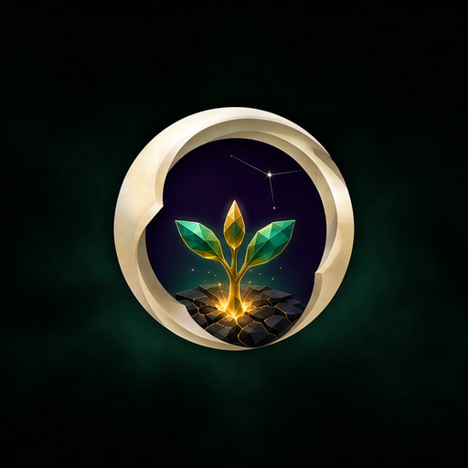
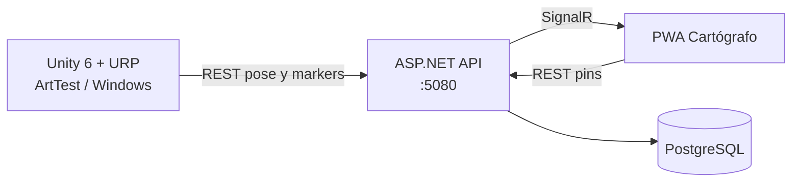

<div align="center">



# NullBorn

**Action-RPG educativo.** El mundo se comporta como software: lo que se rompe se juega; lo que se parchea se aprende.


</div>

Tesis de **Darwin Joan Aveiga Mora** y **Julian Esteban Chavez Zamora**. Un solo repositorio: cliente Unity 6 + URP en la raíz y companion ASP.NET / PostgreSQL / PWA en [`Server/`](Server/).

| | |
|---|---|
| Motor | **Unity 6000.5.10f1** + URP 17.3 (Windows) |
| Escena de trabajo | **NullBorn → Build Art Test Scene** → [`Assets/Scenes/ArtTest.unity`](Assets/Scenes/ArtTest.unity) |
| Companion | API `http://127.0.0.1:5080` · PWA Cartógrafo · PostgreSQL (Docker) |
| Arquitectura | [`ARCHITECTURE.md`](ARCHITECTURE.md) |
| Assets | [`ASSET_STACK.md`](ASSET_STACK.md) |
| Rendimiento | [`PERFORMANCE.md`](PERFORMANCE.md) — meta ≥55 FPS |
| Deploy | [`DEPLOY.md`](DEPLOY.md) |
| Arte Cap 0 | [`docs/CAP0_ART_DIRECTION.md`](docs/CAP0_ART_DIRECTION.md) |
| Guion de demo | [`Server/THESIS_DEMO.md`](Server/THESIS_DEMO.md) |
| Historial | [`CHANGELOG.md`](CHANGELOG.md) |

## Qué es

NullBorn es un action-RPG de fantasía con **isomorfismo informático**: el jugador es un Guardián y el mundo se lee como un sistema (fallos, parches, runtime). El Cap 0 es un reino stylized estable. A partir de ahí el diseño —aún no jugable— salta de género al estilo Split Fiction (shooter, plataformero, *Build Rota*) y cierra en el Runtime. Las habilidades se ganan **jugando** mini-parches de código (semestres 1–2), no con quizzes que sustituyen el combate.

Hoy el repo entrega el **slice Cap 0 en ArtTest** más el mapa táctico en el teléfono. No es el juego completo.

## Estado

| Corre hoy | Planeado |
|---|---|
| Plaza ArtTest (URP Lit, packs Nature/Village) | Reino de Arranque como nivel, no solo plaza |
| Héroe Male_Ranger + Hair_Buzzed + espada única (funda / mano) | Mismo mesh en los 4 mundos; cambian outfit y post |
| Locomoción 3ª persona: walk / run / backpedal / roll | Parkour y combos de Universal Anim Library 2 |
| Melee de un corte + dummy | Combate con enemigos del pack de monstruos |
| Pausa: esquema mouse o solo teclado | Menús de tesis / progreso |
| Minimapa, brújula, pins 3D sincronizados | Quest / inventario |
| PWA Cartógrafo: pins persistentes, pose ~14 Hz vía REST + SignalR | Mundos Protocolo de Fuego, Bucle Vertical, Build Rota |
| Baseline de calidad URP y overlay FPS (F3) | Runtime (epílogo), no cuenta como 5.º mundo MVP |
| Build Windows (`NullBorn → Build Windows Player`) | Audio/música de los packs del stack |

Detalle de arte Cap 0: [`docs/CAP0_ART_DIRECTION.md`](docs/CAP0_ART_DIRECTION.md). Stack de packs: [`ASSET_STACK.md`](ASSET_STACK.md).

## Capturas

No hay screenshots ni GIFs de playtest versionados. Para añadirlos: guardar PNG en `docs/brand/` (por ejemplo `docs/brand/arttest.png`) y enlazarlos en esta sección. El icono del producto ya está aquí: [`docs/brand/nullborn-icon.png`](docs/brand/nullborn-icon.png) (1024, el mismo que el `.exe`).

## Arquitectura



Unity publica la pose por PUT; el API la reenvía por SignalR. El cliente Unity es **offline-first**: si `:5080` no responde, el Play mode sigue en local. Guía de capas: [`ARCHITECTURE.md`](ARCHITECTURE.md). PWA en Render + API local: [`DEPLOY.md`](DEPLOY.md).

## Quick start

### Unity

1. Unity Hub → **Add** → carpeta raíz del repo (debe verse `Assets/`, `Packages/`, `ProjectSettings/`).
2. Editor **6000.5.10f1**.
3. Menú **NullBorn → Build Art Test Scene**.
4. Play en `ArtTest`.

Opcional: **NullBorn → Apply Product Name And Icon**, **NullBorn → Build Windows Player** → `Builds/Windows/NullBorn.exe` (carpeta gitignored).

### Companion (mapa en el navegador)

Hace falta [Docker Desktop](https://www.docker.com/products/docker-desktop/) y SDK **.NET 10**.

```powershell
cd Server
docker compose up -d
cd NullBorn.Api
dotnet run
```

- API + PWA: [http://127.0.0.1:5080](http://127.0.0.1:5080)
- Health: [http://127.0.0.1:5080/api/health](http://127.0.0.1:5080/api/health)

En Unity, el objeto `MapSync` usa `http://127.0.0.1:5080` (no el túnel). Teléfono en la misma Wi‑Fi: `http://<IP-LAN>:5080`. Demo de defensa: [`Server/THESIS_DEMO.md`](Server/THESIS_DEMO.md).

## Estructura

```
NullBorn/
├── Assets/
│   ├── Art/              # Animaciones, materiales, shaders, AppIcon
│   ├── Editor/           # Menús NullBorn (escena, build, Cap 0)
│   ├── Scenes/           # ArtTest.unity
│   ├── Scripts/          # Player, Map, Net, Combat, Art
│   ├── Settings/         # URP
│   └── _ThirdParty/      # Packs aprobados
├── Packages/             # UPM
├── ProjectSettings/
├── Server/               # API, Docker Compose, PWA wwwroot
├── docs/
│   ├── brand/            # Icono de producto para GitHub / docs
│   └── CAP0_ART_DIRECTION.md
├── tools/                # Túnel, scripts de assets
├── ARCHITECTURE.md
├── ASSET_STACK.md
├── PERFORMANCE.md
├── DEPLOY.md
├── CHANGELOG.md
└── README.md
```

`_Inbox/` guarda zips crudos en local y está en `.gitignore`.

## Controles (ArtTest)

Dos esquemas en pausa (**Esc**): **Con mouse** o **Solo teclado**.

| Acción | Con mouse | Solo teclado |
|---|---|---|
| Mover | `W` `A` `S` `D` | igual |
| Cámara | Mouse (cursor bloqueado) | `A` / `D` rotan la cámara |
| Giro del cuerpo | `A` / `D` | el cuerpo sigue a la cámara |
| Sprint | `Shift` + `W` | igual |
| Roll | `Ctrl` o `C` | igual |
| Desenvainar / guardar | `R` o `Q` | igual |
| Ataque | clic izquierdo o `F` | `F` |
| Mapa táctico | `M` | igual |
| Overlay FPS | `F3` | igual |
| Pausa / salir al menú | `Esc` | igual |

Clic en el Game view (esquema mouse, sin pausa) vuelve a bloquear el cursor.

## Equipo y créditos

| | |
|---|---|
| Darwin Joan Aveiga Mora | Diseño, ingeniería, companion |
| Julian Esteban Chavez Zamora | Diseño, ingeniería, contenido |

Entorno y personaje: **Stylized Nature MegaKit**, **Medieval Village MegaKit**, **Universal Base Characters**, **Modular Character Outfits – Fantasy**, **Universal Animation Library**. Lista completa y descartes: [`ASSET_STACK.md`](ASSET_STACK.md). Importados bajo [`Assets/_ThirdParty/`](Assets/_ThirdParty/README.md).

Icono del `.exe`, la PWA y este README: [`Assets/Art/UI/AppIcon.png`](Assets/Art/UI/AppIcon.png), copiado a [`docs/brand/`](docs/brand/).

## Licencia

Repositorio **privado** ([Joan-Mora/NullBorn](https://github.com/Joan-Mora/NullBorn)). No hay `LICENSE` pública. Los packs de Unity Asset Store no se redistribuyen fuera de este proyecto. El código propio del equipo queda reservado hasta que se publique una licencia.
