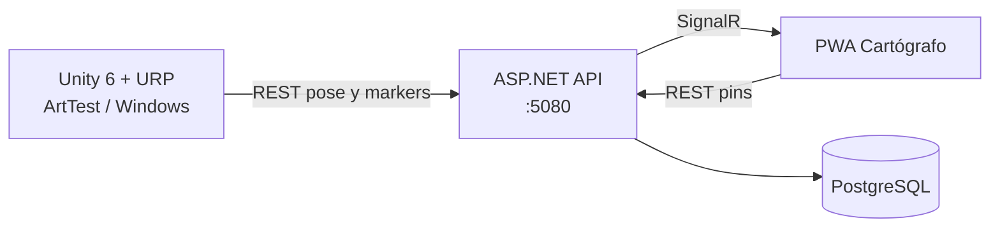

<div align="center">
  
  <h1>NullBorn</h1>
  <p><b>Action-RPG educativo en Unity 6 + URP con mapa táctico web en tiempo real</b><br/>El mundo se comporta como software: lo que se rompe se juega; lo que se parchea se aprende.</p>

  
  
  
  
  
  
  <a href="LICENSE"></a>

  <p><a href="ARCHITECTURE.md">Arquitectura</a> · <a href="ASSET_STACK.md">Assets</a> · <a href="DEPLOY.md">Despliegue</a> · <a href="CHANGELOG.md">Historial</a></p>
</div>

<details>
<summary><b>English summary</b></summary>

NullBorn is an educational action-RPG built as a thesis project by Darwin Joan Aveiga Mora and Julian Esteban Chavez Zamora. The world behaves like software (bugs, patches, runtime): the player is a Guardian who earns abilities by playing small code-patch challenges instead of answering quizzes. The repository holds the Unity 6 (6000.5.10f1) + URP 17.3 client at the root and a companion stack in `Server/`: an ASP.NET Core (.NET 10) API with Entity Framework Core and PostgreSQL, SignalR for real-time updates, and a PWA tactical map that runs on a phone.

Current status: the playable slice is "Chapter 0" in the ArtTest scene (third-person locomotion, single-hit melee against a dummy, minimap, compass and 3D waypoints synced with the phone map). The later genre-shifting worlds are designed but not yet playable.

</details>

## Qué es

NullBorn es un action-RPG de fantasía con **isomorfismo informático**: el jugador es un Guardián y el mundo se lee como un sistema (fallos, parches, runtime). El Cap 0 es un reino stylized estable. A partir de ahí el diseño, aún no jugable, salta de género al estilo Split Fiction (shooter, plataformero, *Build Rota*) y cierra en el Runtime. Las habilidades se ganan **jugando** mini-parches de código (semestres 1 y 2), no con quizzes que sustituyen el combate.

Es la tesis de **Darwin Joan Aveiga Mora** y **Julian Esteban Chavez Zamora**. Un solo repositorio contiene el cliente Unity 6 + URP en la raíz y el companion ASP.NET / PostgreSQL / PWA en [`Server/`](Server/). Hoy el repo entrega el **slice Cap 0 en ArtTest** más el mapa táctico en el teléfono; no es el juego completo.

## Estado

| Corre hoy | Planeado |
|---|---|
| Plaza ArtTest (URP Lit, packs Nature/Village) | Reino de Arranque como nivel, no solo plaza |
| Héroe Male_Ranger + Hair_Buzzed + espada única (funda / mano) | Mismo mesh en los 4 mundos; cambian outfit y post |
| Locomoción en tercera persona: walk / run / backpedal / roll | Parkour y combos de Universal Animation Library 2 |
| Melee de un corte + dummy | Combate con enemigos del pack de monstruos |
| Pausa: esquema mouse o solo teclado | Menús de tesis / progreso |
| Minimapa, brújula, pins 3D sincronizados | Quest / inventario |
| PWA Cartógrafo: pins persistentes, pose a ~14 Hz vía REST + SignalR | Mundos Protocolo de Fuego, Bucle Vertical, Build Rota |
| Baseline de calidad URP y overlay de FPS (F3) | Runtime (epílogo), no cuenta como 5.º mundo del MVP |
| Build Windows (`NullBorn → Build Windows Player`) | Audio/música de los packs del stack |

Detalle de arte del Cap 0: [`docs/CAP0_ART_DIRECTION.md`](docs/CAP0_ART_DIRECTION.md). Meta de rendimiento (≥55 FPS): [`PERFORMANCE.md`](PERFORMANCE.md).

## Arquitectura



- **Cliente offline-first:** Unity publica la pose por `PUT /api/player/{id}` y lee los markers; si `:5080` no responde, el Play mode sigue en local.
- **Tiempo real con SignalR:** el hub `/hubs/game` emite `PlayerPoseUpdated` y `MarkersChanged`, así que la PWA y Unity ven los mismos pins sin recargar.
- **API mínima en ASP.NET Core:** minimal APIs, EF Core con Npgsql y `EnsureCreated` más un seeder de la zona `arttest`, para no depender de `dotnet ef` en cada máquina.
- **Scripts por dominio** en `Assets/Scripts/` (`Player/`, `Map/`, `Net/`, `Combat/`, `Art/`): la lógica de red no se mezcla con el control del avatar y el arte de terceros vive solo en `Assets/_ThirdParty/`.
- **Despliegue híbrido:** la PWA se publica como sitio estático en Render; la API y PostgreSQL corren en el PC y se exponen con un túnel HTTPS.

Guía de capas: [`ARCHITECTURE.md`](ARCHITECTURE.md).

## Stack tecnológico

| Capa | Tecnología |
|---|---|
| Motor | Unity 6000.5.10f1, Universal Render Pipeline 17.3, Input System 1.20 |
| Lenguaje del juego | C# |
| API companion | ASP.NET Core (.NET 10), minimal APIs, SignalR |
| Persistencia | Entity Framework Core 10 + Npgsql, PostgreSQL 16 (Docker) |
| Mapa táctico | PWA (HTML, CSS, JavaScript) servida por la API o desde Render |
| Infraestructura | Docker Compose, Render Static Site, Cloudflare Tunnel |
| Assets | Packs de terceros listados en [`ASSET_STACK.md`](ASSET_STACK.md) |

## Puesta en marcha

### Unity

1. Unity Hub → **Add** → carpeta raíz del repo (debe verse `Assets/`, `Packages/`, `ProjectSettings/`).
2. Editor **6000.5.10f1**.
3. Menú **NullBorn → Build Art Test Scene**.
4. Play en `ArtTest` ([`Assets/Scenes/ArtTest.unity`](Assets/Scenes/ArtTest.unity)).

Opcional: **NullBorn → Apply Product Name And Icon** y **NullBorn → Build Windows Player** → `Builds/Windows/NullBorn.exe` (carpeta ignorada por git).

### Companion (mapa en el navegador)

Hace falta [Docker Desktop](https://www.docker.com/products/docker-desktop/) y el SDK de **.NET 10**.

```powershell
cd Server
docker compose up -d
cd NullBorn.Api
dotnet run
```

- API + PWA: [http://127.0.0.1:5080](http://127.0.0.1:5080)
- Health: [http://127.0.0.1:5080/api/health](http://127.0.0.1:5080/api/health)

En Unity, el objeto `MapSync` usa `http://127.0.0.1:5080` (no el túnel). Teléfono en la misma Wi‑Fi: `http://<IP-LAN>:5080`. Endpoints, acceso a las tablas y solución de problemas: [`Server/README.md`](Server/README.md). Guion de la demo de defensa: [`Server/THESIS_DEMO.md`](Server/THESIS_DEMO.md).

## Despliegue

[`render.yaml`](render.yaml) define un Static Site (`nullborn-pwa`) que publica `Server/NullBorn.Api/wwwroot`. El build ejecuta `tools/write-pwa-config.sh`, que escribe en `config.js` la URL pública de la API tomada de la variable `NULLBORN_API_BASE` (el túnel HTTPS hacia la API local). PostgreSQL y la API siguen en el PC. Paso a paso: [`DEPLOY.md`](DEPLOY.md).

## Controles (ArtTest)

Dos esquemas en pausa (**Esc**): **Con mouse** o **Solo teclado**.

| Acción | Con mouse | Solo teclado |
|---|---|---|
| Mover | `W` `A` `S` `D` | igual |
| Cámara | Mouse (cursor bloqueado) | `A` / `D` rotan la cámara |
| Giro del cuerpo | `A` / `D` | el cuerpo sigue a la cámara |
| Sprint | `Shift` + `W` | igual |
| Roll | `Ctrl` o `C` | igual |
| Desenvainar / guardar | `R` o `Q` | igual |
| Ataque | clic izquierdo o `F` | `F` |
| Mapa táctico | `M` | igual |
| Overlay FPS | `F3` | igual |
| Pausa / salir al menú | `Esc` | igual |

Clic en el Game view (esquema mouse, sin pausa) vuelve a bloquear el cursor.

## Estructura del repositorio

```
NullBorn/
├── Assets/
│   ├── Art/              # Animaciones, materiales, shaders, AppIcon
│   ├── Editor/           # Menús NullBorn (escena, build, Cap 0)
│   ├── Scenes/           # ArtTest.unity
│   ├── Scripts/          # Player, Map, Net, Combat, Art
│   ├── Settings/         # URP
│   └── _ThirdParty/      # Packs aprobados
├── Packages/             # UPM
├── ProjectSettings/
├── Server/               # API, Docker Compose, PWA wwwroot
├── docs/
│   ├── brand/            # Icono de producto para GitHub / docs
│   └── CAP0_ART_DIRECTION.md
├── tools/                # Túnel, scripts de assets
├── ARCHITECTURE.md
├── ASSET_STACK.md
├── PERFORMANCE.md
├── DEPLOY.md
├── CHANGELOG.md
└── README.md
```

`_Inbox/` guarda zips crudos en local y está en `.gitignore`.

## Documentación

| Tema | Documento |
|---|---|
| Arquitectura | [`ARCHITECTURE.md`](ARCHITECTURE.md) |
| Assets | [`ASSET_STACK.md`](ASSET_STACK.md) |
| Rendimiento | [`PERFORMANCE.md`](PERFORMANCE.md) |
| Despliegue | [`DEPLOY.md`](DEPLOY.md) |
| Arte Cap 0 | [`docs/CAP0_ART_DIRECTION.md`](docs/CAP0_ART_DIRECTION.md) |
| Companion | [`Server/README.md`](Server/README.md) |
| Guion de demo | [`Server/THESIS_DEMO.md`](Server/THESIS_DEMO.md) |
| Historial | [`CHANGELOG.md`](CHANGELOG.md) |

## Autoría

<table>
  <tr>
    <td align="center"><a href="https://github.com/Joan-Mora"><br/><b>Darwin Joan Aveiga Mora</b></a><br/><sub>Diseño, ingeniería y companion (API, PostgreSQL, PWA)</sub></td>
    <td align="center"><a href="https://github.com/MrRoar154"><br/><b>Julian Esteban Chavez Zamora</b></a><br/><sub>Diseño, ingeniería y contenido</sub></td>
  </tr>
</table>

Proyecto de tesis de ambos autores.

### Créditos de terceros

Entorno y personaje: **Stylized Nature MegaKit**, **Medieval Village MegaKit**, **Universal Base Characters**, **Modular Character Outfits – Fantasy**, **Universal Animation Library**. Lista completa y descartes: [`ASSET_STACK.md`](ASSET_STACK.md). Importados bajo [`Assets/_ThirdParty/`](Assets/_ThirdParty/README.md).

Icono del `.exe`, la PWA y este README: [`Assets/Art/UI/AppIcon.png`](Assets/Art/UI/AppIcon.png), copiado a [`docs/brand/`](docs/brand/).

## Licencia

Copyright © 2026 Darwin Joan Aveiga Mora y Julian Esteban Chavez Zamora. **Todos los derechos reservados.**

Este repositorio es público para que el código pueda consultarse como parte de nuestro portafolio. Eso no concede permiso para copiarlo, reutilizarlo, modificarlo, distribuirlo ni presentarlo como trabajo propio. Los términos completos están en [`LICENSE`](LICENSE). Para cualquier uso, escribe a [darwin@abacore.co](mailto:darwin@abacore.co).

Los packs de terceros incluidos en [`Assets/_ThirdParty/`](Assets/_ThirdParty/) conservan sus propias licencias y no están cubiertos por la licencia de este proyecto.

<div align="center">
<sub>Hecho por <a href="https://github.com/Joan-Mora">Darwin Aveiga</a> · <a href="https://abacore.co">Abacore S.A.S.</a></sub>
</div>
