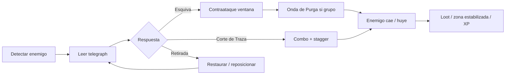

# GDD v2 — NullBorn: Guardián del Runtime

**Versión:** 2.0 (borrador aprobado para pivot)  
**Fecha:** 2026-08-26  
**Estado:** Visión creativa + mecánicas — **sin implementación Unity en esta fase**  
**Reemplaza:** [`GDD_v1.md`](GDD_v1.md) como documento de diseño principal. v0/v1 se conservan como referencia del vertical slice legacy.

---

## 0. Auditoría honesta del prototipo (baseline real)

*Leído del código en `Assets/Scripts/` y prefab `Player_Thread` — no asumir lo que dice la documentación anterior.*

### Lo que SÍ existe (esqueleto funcional)

| Componente | Realidad |
|---|---|
| `ThirdPersonController` | WASD + gravedad + rotación hacia movimiento. Sin sprint, dodge, bloqueo ni aceleración. |
| `ThirdPersonCamera` | Orbit mouse básico. Sin shake, zoom combat, ni reorientación suave al lock-on. |
| `DebugStrikeAbility` | `OverlapSphere` instantáneo al pulsar Click/F. Gasta CPU. **Cero** animación, VFX, hitstop o sonido de impacto. |
| `GarbageCollectionAbility` | AoE instantáneo (E/G): daña leaks, recoge fragmentos, cura integridad. Solo `GcPulseVfx` al usar GC. |
| `MemoryLeakEnemy` | **Estático.** Drena integridad pasivamente, crece en escala, spawnea cubos fragmento. Sin IA de combate, telegraphs ni ataques activos. |
| `PlayerAnimBridge` | Existe en código pero **no está en el prefab**. Preparado para Mixamo futuro. |
| `Player_Thread` prefab | Primitivas (capsule/sphere). `SimpleBobAnim` = bob vertical idle. **Sin Animator.** |
| `CanvasHUD` | Barras Integridad/CPU/leak + texto tutorial. Controles crammed en una línea. |
| `DemoBootstrap` | Cableado demo lineal. Funciona como sandbox de sistemas, no como combate pulido. |

### Lo que está roto o se siente mal

1. **Avatar estático / muerto:** El personaje desliza por el suelo; piernas y brazos no ciclan. El único movimiento visual es un bob sinusoidal de 5 cm.
2. **Combate invisible:** Ataque = esfera de colisión invisible. El jugador no sabe si golpeó, falló por rango o por falta de CPU (solo `Debug.Log`).
3. **Loop confuso:** GC es ataque + curación + limpieza ambiental en un botón. Debug Strike compite sin identidad clara. ¿Cuándo atacar vs limpiar? No hay lectura corporal ni feedback.
4. **Enemigos pasivos ridículos:** Un blob que crece mientras drena HP global no invita a “combate”; invita a spamear GC antes de morir. No hay presión espacial ni timing.
5. **Presión opaca:** Integridad baja sola; CPU regenera sola. El jugador no siente tradeoffs moment a moment.
6. **Isomorfismo como jaula:** Nombres técnicos en HUD y habilidades priorizan la metáfora sobre la legibilidad del juego.
7. **“Combate sólido” es falso:** El vertical slice demuestra *conceptos* enlazados, no *game feel*. No cumple estándar mínimo de action-RPG jugable.

**Conclusión:** El codebase es un **proof-of-concept pedagógico**, no una base de combate lista para open world. **Fase 0b (fundación de game feel)** es obligatoria antes de terreno, quests o biomas.

---

## 1. Identidad del juego

### Una frase

> **NullBorn es un action-RPG ágil de tercera persona donde patrullas un ecosistema digital en colapso, purgando corrupciones con combate legible y exploración con propósito — la informática es sabor y lore, no el manual de instrucciones.**

### Pilares (4)

| # | Pilar | Significado |
|---|---|---|
| 1 | **Combate legible** | Cada acción se ve, se oye y se entiende en &lt;0,5 s. Telegraphs claros. Feedback consistente. |
| 2 | **Agencia del Guardián** | Tú decides cuándo esquivar, presionar, purgar o retirarte. El mundo castiga la pasividad, no la ignorancia del jargon. |
| 3 | **Exploración con tensión** | Regiones distintas, rutas, secretos y encuentros opcionales — no un mapa vacío ni un pasillo de tutorial. |
| 4 | **Aprendizaje por acción** | Los conceptos de sistemas (memoria, CPU, procesos) emergen de situaciones de juego, explicados en UI opcional o diálogo — nunca bloqueando el fun. |

### Fantasía emocional del jugador

No “eres un Thread”. **Eres un Guardián de Runtime** — un agente de mantenimiento de élite enviado a las capas profundas de un sistema que se desangra. Emocionalmente:

- **Competencia:** dominar patrones enemigos y sentirse hábil.
- **Urgencia:** la corrupción se expande; el reloj es la estabilidad del mundo.
- **Curiosidad:** cada región es un distrito distinto del mismo organismo digital (arquitectura, color, audio).
- **Alivio tras tensión:** derrotar un nodo corrupto estabiliza la zona — feedback visual y sonoro de “orden restaurado”.

### Referencias de feel (no de contenido)

| Referencia | Qué tomamos |
|---|---|
| **Hades** | Impacto snappy, dash con i-frames, claridad de hit feedback, identidad de cada ataque. |
| **Zelda: Breath of the Wild** | Lock-on opcional, cámara que respeta al jugador, exploración libre con objetivos visibles. |
| **Dark Souls (lite)** | Stamina como recurso de decisiones, no castigo gratuito. Enemigos telegrafían. |
| **Hyper Light Drifter / Signalis** | Estética digital-melancólica como inspiración visual — no gameplay roguelike. |

### Anti-patrones (lo que NO repetir)

- Ataques sin animación ni VFX (“OverlapSphere simulator”).
- Enemigos que solo existen como medidor de HP global.
- Una habilidad que hace todo (GC actual).
- HUD lleno de términos OS sin iconografía clara.
- Personaje que patina en T-pose mental.
- Bloquear diseño open world hasta que el combate de un solo enemigo sea **divertido** en 60 s de playtest.

---

## 2. Temática: sabor informático, no jaula abstracta

### Enfoque principal — **“Ciudad-Runtime”**

El mundo es una **metrópolis infraestructural** estilizada: torres de stack, plazas de arranque, barrios heap, desiertos de E/S. La corrupción es **moho digital** (magenta, glitch, niebla). Los NPCs son **servicios personificados** (mensajero, archivero, reloj del sistema).

| Capa | Uso en juego | Uso pedagógico |
|---|---|---|
| **Nombres y lore** | Distritos, facciones, ítems | Glosario opcional |
| **UI** | Iconos primero; tooltip con término real | Refuerzo post-acción |
| **Mecánicas ocasionales** | “Sobrecarga de RAM” como debuff de zona | 1 concepto por región, no por botón |
| **Narrativa** | Tickets, logs, terminales | Contexto diegético |

**Integridad** y **CPU** se renombran en HUD principal a **Vitalidad** y **Energía** (subtítulo: “Integridad del sistema” / “Ciclos de CPU” en tooltip). El estudiante que quiera profundizar, profundiza; el jugador casual juega un ARPG claro.

### Alternativas temáticas (si el equipo pivota narrativa)

1. **“Expedición post-crash”** — Tras el colapso de un mega-servidor, equipos de rescate entran en simulaciones corruptas. Más sci-fi, menos “dentro del OS”.
2. **“Paisaje onírico de depuración”** — Entorno surreal, enemigos como bugs personificados. Metáfora computing muy sutil; prioriza arte y mood.
3. **“Operadores de red viva”** — Mundo más “cyberpunk limpio”: cables, antenas, nodos. Enfatiza conectividad y flujo de datos en quests.

*Recomendación:* **Ciudad-Runtime** equilibra identidad NullBorn, legibilidad visual y tesis UNIMINUTO.

---

## 3. Combate — diseño objetivo

### 3.1 Movimiento del jugador

| Acción | Input | Comportamiento |
|---|---|---|
| Caminar / correr | WASD (Shift = correr, gasta Energía leve) | Blend tree locomotion; rotación hacia input/cámara. |
| Esquiva (Dash) | Espacio | Impulso corto, **12–18 frames i-frames**, cancelable al final en ataque ligero. Gasta Energía fija. |
| Lock-on | Q / click rueda | Soft lock al target más centrado en pantalla; strafe alrededor; cámara acorta distancia levemente. |
| Interactuar | E | Contextual (NPC, terminal, loot). **Ya no GC en E.** |

**Controller:** Procedural movement (CharacterController) + **animación sincronizada** (no root motion obligatorio en MVP; root motion solo en ataques pesados si simplifica impact timing).

**Input buffer:** 150–200 ms para ataque y esquiva tras fin de recovery — sensación moderna sin complicar el código.

### 3.2 Kit de combate (reemplazo/evolución de Debug Strike + GC)

#### Ataque primario — **Corte de Traza** (evolución de Debug Strike)

- Combo 3 golpes: ligero → ligero → fuerte (L-L-H).
- Arco visible (trail cian), hitbox delante del personaje alineada a animación.
- Cada golpe: coste Energía bajo, daño moderado, **hitstop 40–60 ms** en connect.
- Finisher H: knockback leve en leaks pequeños.

#### Habilidad especial — **Onda de Purga** (evolución parcial de GC ofensivo)

- Cooldown 8–10 s (no spam). Consumo Energía medio-alto.
- AoE circular a tu alrededor: daño fuerte a corrupciones, destruye fragmentos, **no cura**.
- Animación de carga 0,4 s (vulnerable) → pulso URP + bajo camera shake.
- *Sabor diegético:* “GC agresivo” / recolección forzada.

#### Habilidad de soporte — **Restaurar** (nueva, parte del antiguo GC)

- Cooldown 12 s. Canalización 0,6 s.
- Restaura Vitalidad; bonus si no hay enemigos en melee range (premia reposicionamiento).
- VFX verde-cian ascendente — distinto de Purga.

#### Parry opcional (P1 post-MVP combate)

- Ventana estrecha vs telegraphs “pesados”. Stagger garantizado.
- Introducir en 1 mini-boss, no en MVP inicial.

### 3.3 Feedback obligatorio (checklist Fase 0b)

- [ ] Animación ataque + locomotion blend
- [ ] SFX hit / miss / dodge
- [ ] Hitstop en impacto
- [ ] Flash emisión en enemigo al recibir daño
- [ ] Números de daño opcionales (toggle en accesibilidad)
- [ ] Camera shake sutil en golpe fuerte y Purga
- [ ] Indicador de Energía insuficiente (UI + sonido “deny”)

### 3.4 Diagrama del loop de combate



---

## 4. Personaje jugable — requisitos de animación

**Modelo:** Sustituir primitivas por rig humanoide (Blender → Mixamo mínimo viable).

| Estado | Clips mínimos | Notas |
|---|---|---|
| Locomotion | idle, walk, run | Blend por Speed (PlayerAnimBridge ya expone parámetro) |
| Combate | attack_L1, attack_L2, attack_H, purge_cast, restore_cast | Eventos de animación = hit frames |
| Reacción | hit_front, death | Interrupt locomotion |
| Esquiva | dodge_f / dodge_b | Root pequeño forward; i-frames en ventana marcada |
| Transición | draw weapon / holster (opcional P1) | Para hubs seguros |

**Prohibido en builds posteriores a Fase 0b:** prefab de jugador sin Animator funcional en escena principal.

---

## 5. Diseño de enemigos

### Principios

1. **Telegraph antes de daño** — cambio de color, windup, sonido 0,5–1,2 s.
2. **Un rol por arquetipo** — chaser, artillery, spawner, tank.
3. **Corrupción leíble** — silueta + color antes que nombre en HUD.
4. **Muerte satisfactoria** — dissolve + partículas + drop claro.

### Arquetipos MVP (evolución de Memory Leak)

| Enemigo | Comportamiento | Metáfora (sabor) |
|---|---|---|
| **Goteo** (Basic) | Lento, melee telegraph corto, poco HP | Memory leak menor |
| **Propagador** (Spawner) | Mantiene distancia, spawnea minions si no se interrumpe | Leak que multiplica referencias |
| **Núcleo Corrupto** (Boss) | 2 fases: drenaje aura + burst AoE telegrafiado | Proceso zombie / ENRAGE |
| **Referencia Nula** (nuevo P1) | Blink corto tras ataque | NullReference — requiere timing |

**MemoryLeakEnemy actual:** refactorizar de “bola que crece” a **FSM simple**: Idle → Telegraph → Attack → Recover → (opcional) Enrage. El drenaje pasivo de Vitalidad global baja a **aura telegrafiada** en fase 2 del boss, no constante en adds.

### Fragmentos de memoria

- Pasan de “cubos spawn aleatorio” a **peligros ambientales**: ocasionalmente explotan si no se purgan; Onda de Purga los limpia en cadena (combo satisfaction).

---

## 6. Cámara y HUD

### Cámara

- Distancia default 5,5 m; lock-on → 4,5 m con lerp.
- Pitch clamp actual OK; añadir **offset lateral leve** al strafe en lock.
- Shake parametrizable (ScriptableObject `CombatFeelConfig` futuro).

### HUD (jerarquía clara)

```
┌─────────────────────────────────────────────┐
│ [Vitalidad ████████░░] [Energía ██████░░░░] │
│ [Objetivo: Goteo ███░░]  (solo en combate)   │
├─────────────────────────────────────────────┤
│                    (mundo)                   │
├─────────────────────────────────────────────┤
│ [Quest tracker compacto]     [Minimapa P1]  │
└─────────────────────────────────────────────┘
```

- Controles en pantalla de pausa / primera vez — no en footer permanente.
- Tutorial: bocadillos contextuales **después** de la primera acción, no muro de texto al boot.

---

## 7. Mundo abierto (alcance v2)

Mantiene la estructura **Hub + biomas** de [`WORLD_RPG_PLAN.md`](WORLD_RPG_PLAN.md), con estos ajustes:

- **No iniciar Fase 1 (terreno)** hasta completar **Fase 0b** con criterio: *“1 arena, 3 enemigos Goteo, 60 s de combate divertido”* (playtest interno).
- Progresión, quests, inventario — sin cambio de prioridad P0, pero **dependientes** de combate legible.
- Demo_10min → **“Simulación de arranque (legacy)”** embebida en hub; no referencia de calidad de combate.

### Isomorfismo v2 (tabla reducida — flavor)

| En juego (HUD) | Término técnico (tooltip / codex) |
|---|---|
| Vitalidad | Integridad del sistema |
| Energía | Ciclos de CPU |
| Corrupción / Goteo | Memory leak |
| Onda de Purga | Garbage collection ofensivo |
| Restaurar | Recuperación / GC defensivo |
| Prioridad (XP) | Prioridad de thread |

---

## 8. Fuera de alcance (v2)

- Multijugador
- Combate aéreo complejo
- 10+ tipos de enemigo antes de pulir 3
- Cinemáticas largas
- Quizzes obligatorios
- Open world &gt; 600×600 m en MVP tesis

---

## 9. Criterios de aceptación — Fase 0b (game feel)

| # | Criterio | Medición |
|---|---|---|
| 1 | Jugador tiene walk/run/dodge/3-hit combo animados | Review en Play Mode |
| 2 | Golpe conectado siempre tiene SFX + hitstop + flash enemigo | 10 combates seguidos |
| 3 | Enemigo Goteo telegrapha y ataca | Jugador puede esquivar ≥3 veces seguidas |
| 4 | Onda de Purga y Restaurar visualmente distintas | Test A/B interno |
| 5 | HUD muestra Vitalidad/Energía sin jerga obligatoria | Captura |
| 6 | Ningún ataque usa solo OverlapSphere sin anim/VFX | Code review |

---

## 10. Documentos relacionados

- [`WORLD_RPG_PLAN.md`](WORLD_RPG_PLAN.md) — fases, arquitectura, Fase 0b
- [`GDD_v1.md`](GDD_v1.md) — demo 10 min (legacy)
- [`GDD_v0.md`](GDD_v0.md) — borrador inicial
- [`ARCHITECTURE.md`](../ARCHITECTURE.md) — implementación técnica

---

*NullBorn v2: primero se siente bien; después crece el mundo.*
